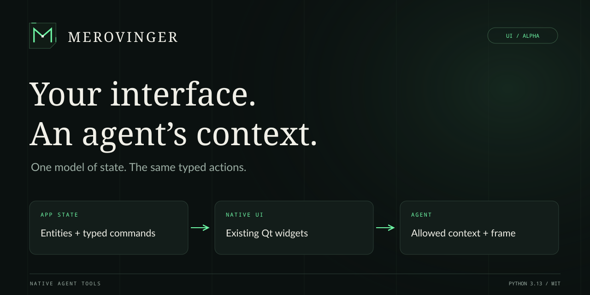
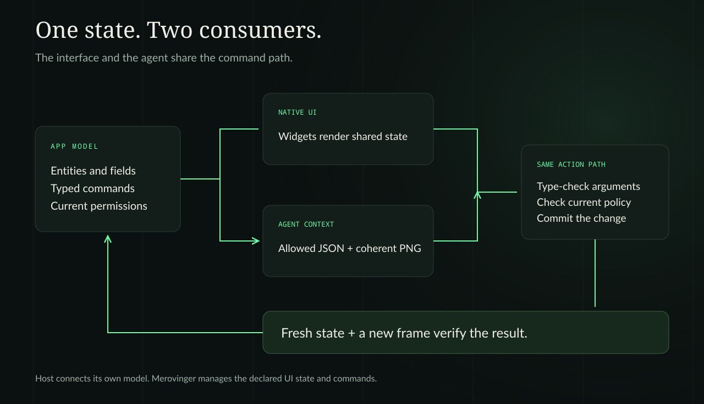
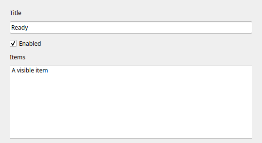

# Merovinger UI

**Native Qt interfaces and agent context, driven by the same state and typed commands.**

Python 3.13 · PySide6 · Alpha · [MIT](LICENSE) · [Русский](README.ru.md)

Bind a small, explicit set of Qt widgets to your application state. Your users
interact with native controls; your own agent receives policy-filtered JSON and
an approved PNG of the managed surface. Both use the same typed commands.



1. **Declare** a Registry, typed state and command handlers.
2. **Bind** managed Qt controls to those fields and commands.
3. **Observe → act → verify:** take a coherent context/frame packet, invoke a
   bound action, then observe the committed result.

## Try it

Install from this repository; no PyPI release is required.

```bash
git clone https://github.com/k4raga/merovinger-ui.git
cd merovinger-ui
python -m pip install .
python examples/ui_agent/main.py --smoke --report .runtime/demo.json
```

Use **Python 3.13** in a virtual environment. Or install the library directly:

```bash
python -m pip install "git+https://github.com/k4raga/merovinger-ui.git"
```

The [self-contained example](examples/ui_agent/main.py) opens a real Qt window
with an existing line edit, checkbox and list. A tiny local agent reads JSON and
PNG, chooses a typed toggle, and checks a new packet. It makes **no model or
network calls**. Substitute your own model adapter at that boundary.



The distribution is `merovinger-ui`; Python imports remain `agent_native`.

## Small API, explicit ownership

Inside your existing Qt event loop:

```python
from agent_native.ui import Destination

pending = bridge.observe_for_model(destination=Destination(
    "my-agent", "custom-python", "owner", "adapter-v1"
))

# Call from a later host timer tick; poll() does not run a hidden event loop.
if pending.poll():
    with pending.take() as packet:
        my_adapter(packet.context_json, packet.images)  # image.png is bytes

# Agent output uses a declared control and its existing typed command.
bridge.invoke("enabled", False)
```

`take()` checks current authorization and expiry before handing bytes to the
trusted host. Intake acceptance is not commit completion. Close packet/observation
owners and keep polling `bridge.close()` until it returns `True`, then close the
runtime. See the [quickstart](docs/quickstart.md) for the complete lifecycle.

## Supported surface

Generated controls and explicit adoption of these **six exact Qt classes**:

| Qt widget | Declaration |
| --- | --- |
| `QLabel` | `text` |
| `QPushButton` | `button` |
| `QLineEdit` | `editor` |
| `QListView` | `list_view` |
| `QCheckBox` | `toggle` |
| `QSpinBox` | `number` |

Existing widgets must occupy direct `QBoxLayout` slots beneath the host parent.
This is an integration library: state, commands and bindings are declared by the
application, not inferred from arbitrary existing windows.

- SQLite-backed state and typed command admission.
- Read-only views with real scoped read grants.
- Context and PNG tied to one published state revision.
- Current-policy checks, bounded retained assets and explicit cleanup.
- No required Runner, model SDK, Memory or Programs package.

## Verification and scope

The exported SDK has passed **9 standalone UI cases on Windows 11 LTSC** with
Python 3.13.17 and Qt 6.12.0 using the native `windows` backend, plus a real
context/PNG → typed change → fresh packet example. This is scoped validation of
the source snapshot, not a promise about every Windows version or application.

Ubuntu offscreen checks and the current repository's reproducible commands are
listed in [verification](docs/verification.md). macOS native behavior is not
verified. This release is **alpha**; review the [limits](docs/limits.md).

[Quickstart](docs/quickstart.md) · [Architecture](docs/architecture.md) ·
[Contributing](CONTRIBUTING.md) · [Changelog](CHANGELOG.md) ·
[Memory library](https://github.com/k4raga/merovinger-memory)
