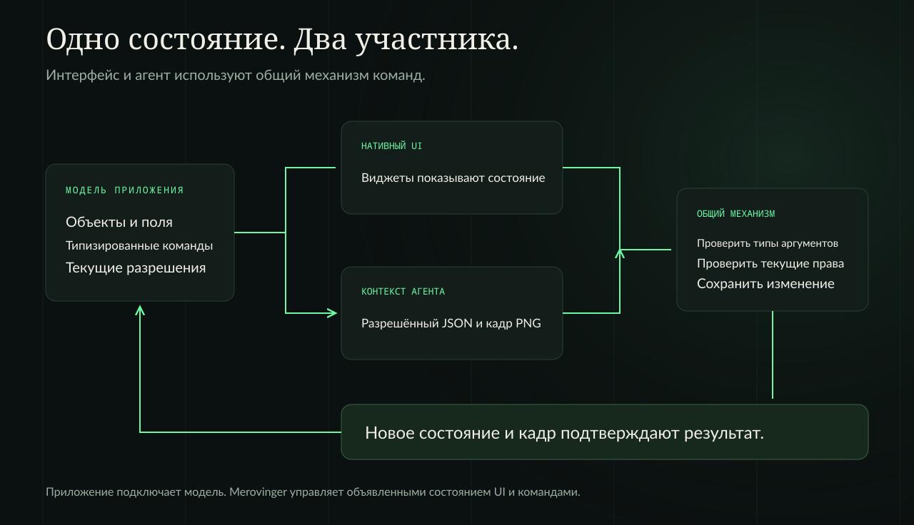
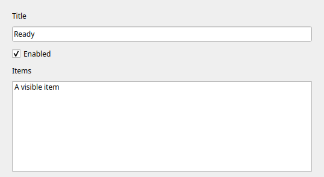

[English](README.md) · **Русский**


# Merovinger UI

Для нового экрана задайте [описание симбиотического интерфейса](docs/quickstart.ru.md).
Из него Merovinger строит нативное представление и доступные агенту действия.

**Нативный Qt-интерфейс и контекст агента из одного состояния и типизированных команд.**

Python 3.13 · PySide6 · Альфа · [MIT](LICENSE)

Свяжите поддерживаемые Qt-виджеты с состоянием приложения. Пользователь работает
с нативными контролами, а ваш агент получает отфильтрованный политикой JSON и
разрешённый PNG управляемой области. Команды и состояние у них общие.



1. **Опишите** Registry, типы состояния и обработчики команд.
2. **Свяжите** Qt-контролы с полями и типизированными действиями.
3. **Наблюдайте → действуйте → проверяйте:** получите согласованные контекст и
   кадр, вызовите объявленное действие, затем проверьте опубликованный результат.

## Запуск

Установите из репозитория; опубликованный пакет на PyPI не требуется.

```bash
git clone https://github.com/k4raga/merovinger-ui.git
cd merovinger-ui
python -m pip install .
python examples/ui_agent/main.py --smoke --report .runtime/demo.json
```

Нужен **Python 3.13**; используйте виртуальное окружение. Библиотеку также можно
установить напрямую:

```bash
python -m pip install "git+https://github.com/k4raga/merovinger-ui.git"
```

[Самодостаточный пример](examples/ui_agent/main.py) открывает Qt-окно с полем ввода,
флажком и списком. Простой локальный агент читает JSON и PNG, выбирает
типизированное переключение и проверяет новый пакет. **Вызовов модели и сети нет.**
На этой границе можно подключить собственный адаптер модели.



Имя пакета — `merovinger-ui`; пространство имён импорта Python сохранено как `agent_native`.

## Явный API и жизненный цикл

В существующем цикле событий Qt приложения:

```python
from agent_native.ui import Destination

pending = bridge.observe_for_model(destination=Destination(
    "my-agent", "custom-python", "owner", "adapter-v1"
))

# В следующем тике таймера приложения; скрытого цикла событий внутри poll() нет.
if pending.poll():
    with pending.take() as packet:
        my_adapter(packet.context_json, packet.images)  # image.png — байты

bridge.invoke("enabled", False)
```

`take()` повторно проверяет текущие права и срок действия перед передачей байтов
доверенному коду приложения. Приём команды ещё не означает сохранение изменения.
Закрывайте владельцев пакетов и наблюдений, продолжайте вызывать
`bridge.close()` до `True`, затем закрывайте среду выполнения.
Полный пример — в [руководстве по подключению](docs/quickstart.ru.md).

## Поддерживаемая область

Генерируемые контролы и явное подключение **шести точных Qt-классов**:

| Виджет | Объявление |
| --- | --- |
| `QLabel` | `text` |
| `QPushButton` | `button` |
| `QLineEdit` | `editor` |
| `QListView` | `list_view` |
| `QCheckBox` | `toggle` |
| `QSpinBox` | `number` |

Существующие виджеты должны занимать прямые слоты `QBoxLayout` под переданным родительским виджетом.
Приложение явно задаёт состояние, команды и привязки; произвольные готовые окна
автоматически не распознаются.

- Состояние в SQLite и проверяемые типизированные команды.
- Представления только для чтения с ограниченными разрешениями.
- Контекст и PNG из одной опубликованной ревизии.
- Проверка текущей политики, ограниченное хранение изображений, явная очистка.
- Runner, SDK модели, Memory и Programs для работы не требуются.

## Проверки и границы

Экспортированный SDK прошёл **9 самостоятельных UI-проверок на Windows 11 LTSC**:
Python 3.13.17, Qt 6.12.0, нативный режим Qt `windows`. Также проверен пример
контекст/PNG → типизированное изменение → свежий пакет. Это проверка конкретного
снимка исходников, а не всех версий Windows и приложений.

Ubuntu offscreen-проверки и команды воспроизведения — в
[разделе проверок](docs/verification.ru.md). Нативная работа на macOS пока не проверена.
Версия **альфа**; прочитайте [ограничения](docs/limits.ru.md).

[Быстрый старт](docs/quickstart.ru.md) · [Архитектура](docs/architecture.ru.md) ·
[Участие](CONTRIBUTING.ru.md) · [Изменения](CHANGELOG.ru.md) ·
[Memory](https://github.com/k4raga/merovinger-memory/blob/main/README.ru.md)
