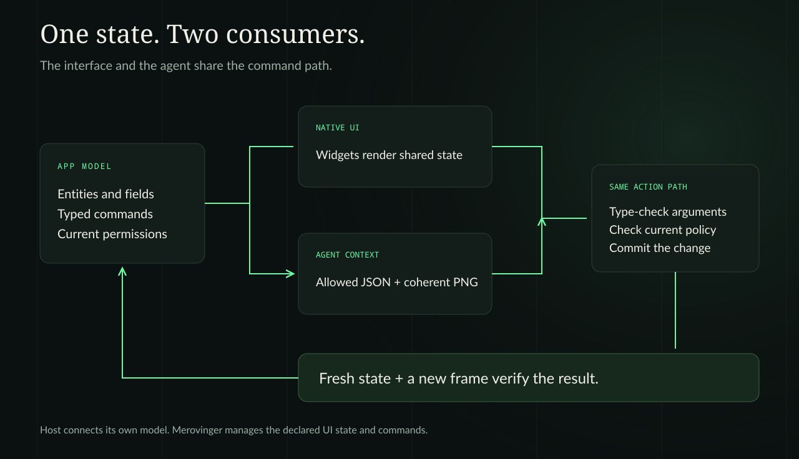

**English** · [Русский](architecture.ru.md)

# One state, two views

## 1. State and typed commands

A Registry defines entity fields, relations and commands. UiRuntime uses one
state store, one typed command admission path and SQLite persistence.
A command handler returns a proposed Patch; admission and durable publication
decide whether it becomes state. Widgets and agents do not maintain competing
domain stores.

## 2. Managed native presentation

Declarations bind fields, collections and Actions to controls. EngineUi renders
a published state revision. AppBridge embeds it into an existing Qt host and
can temporarily adopt supported widgets, restoring their managed properties
and original layout placement on completed detach.

Focus, drafts and selection are managed UI state. They are distinct from
committed domain fields. Read-only views receive scoped read grants without
command permissions.

## 3. Coherent observation and action

ContextIndex projects typed state and available commands under current policy.
CaptureService captures only the registered managed surface. ExportBroker
checks paint provenance and encodes approved pixels on a bounded CPU worker.
Context and image stamps identify the same published cut.

The provider-neutral model handoff rechecks current authorization, provenance,
destination and expiry. Context serialization and retained image leases share
bounded accounting; a handle is not permission to export raw capture data.

Your model adapter is outside this library. It can consume the prepared JSON
and PNG and choose a bound action. The command still follows the original
admission path. Fresh observation verifies the published result.

## Ownership

The application owns QApplication and its normal event loop. UiRuntime owns
its runtime and database; bridges own managed views; observation/payload owners
own retained export resources. Close is explicit and may report pending work.
No background inference, provider SDK or second command gateway is introduced.

See [limits](limits.md) for the finite widget and trust boundaries.
