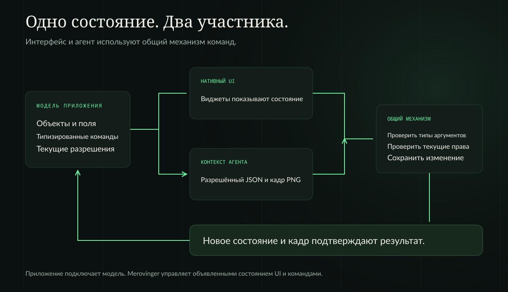

[English](architecture.md) · **Русский**

# Одно состояние, два представления

## 1. Состояние и типизированные команды

Registry определяет поля сущностей, связи и команды. UiRuntime использует
одно хранилище состояния, общий путь допуска типизированных команд и сохранение
в SQLite. Обработчик команды возвращает предложенный Patch; допуск и надёжная
публикация определяют, станет ли он состоянием. Виджеты и агенты не ведут
конкурирующие предметные хранилища.

## 2. Управляемое нативное представление

Объявления связывают поля, коллекции и Actions с контролами.
EngineUi отображает опубликованную ревизию состояния. AppBridge встраивает её
в существующее Qt-приложение и может временно взять под управление поддерживаемые
виджеты. После завершённого отсоединения их управляемые свойства и исходное
положение в компоновке восстанавливаются.

Фокус, черновики и выбор — управляемое состояние интерфейса. Оно отделено
от сохранённых предметных полей. Представления только для чтения получают
ограниченные разрешения чтения без прав на команды.

## 3. Согласованное наблюдение и действие

ContextIndex формирует представление типизированного состояния и доступных команд
с учётом текущей политики. CaptureService захватывает только зарегистрированную
управляемую область. ExportBroker проверяет происхождение отрисовки и кодирует
разрешённые пиксели в ограниченном CPU-воркере. Метки контекста и изображения
указывают на один опубликованный срез состояния.

Передача данных модели не привязана к провайдеру и повторно проверяет текущие
права, происхождение, получателя и срок действия. Сериализация контекста
и удерживаемые изображения учитываются в общих лимитах; дескриптор сам по себе
не разрешает экспорт исходного захвата.

Адаптер модели находится за пределами библиотеки. Он может получить готовые
JSON и PNG и выбрать привязанное действие. Команда проходит исходный путь
допуска. Новое наблюдение проверяет опубликованный результат.

## Владение ресурсами

Приложение владеет QApplication и обычным циклом событий.
UiRuntime владеет своими runtime и базой данных; bridges — управляемыми
представлениями; владельцы наблюдений и пакетов — удерживаемыми ресурсами экспорта.
Завершение явное и может сообщать о незавершённой работе.
Фонового вызова модели, SDK провайдера и второго шлюза команд нет.

Конечный набор виджетов и границы доверия описаны в [ограничениях](limits.ru.md).
